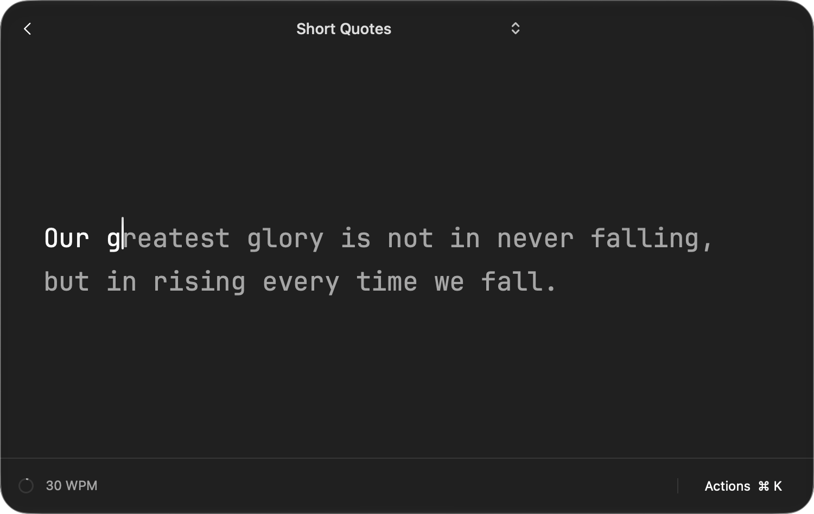

# monkeytype-unoffical

A Monkeytype-powered **typing practice extension for [Tinycast](https://tinycast.dev/)**. Practice quotes or timed sessions in a native macOS window.

## Install in Tinycast

Requires macOS 26+, Tinycast, and internet access.

### From GitHub

Use Tinycast’s **Install from GitHub** option with `https://github.com/paradox-sp/tinycast-monkeytype`. Tinycast builds and installs the extension automatically. Requires Node.js 22+ with npm and Swift 6.2+ command-line tools.

### From a folder

Run `npm run build` locally, then choose **Settings → Extensions → Install → Add from folder** and select **`dist/`**.

Download a ZIP from [Releases](https://github.com/paradox-sp/tinycast-monkeytype/releases), extract it, and select its enclosed **`dist/`** folder instead. Prebuilt packages support Apple Silicon and Intel without build tools.

Downloaded builds are ad-hoc signed, not notarized; macOS may block them. If blocked, use a GitHub/local source build rather than bypassing security checks.

Run **Start monkeytype-unoffical** from Tinycast. To update, quit the helper with ⌘Q and reinstall using the same method; folder installations do not auto-update.

**Compatibility:** Tinycast only. Raycast is not currently supported.

## Development

`npm run dev` previews the built helper without Tinycast. No `npm install` step is needed.

Push a tag matching `package.json` (for example, `v1.0.0`) to build and publish a release automatically with GitHub Actions. See [release instructions](docs/development.md#prepare-a-public-release).

## Documentation

- [Usage and shortcuts](docs/usage.md)
- [Architecture and scoring](docs/architecture.md)
- [Development, installation, and verification](docs/development.md)

## License

Project code: [MIT](LICENSE). Bundled JetBrains Mono: [SIL OFL 1.1](assets/fonts/OFL.txt).

**Author:** [paradox-sp](https://github.com/paradox-sp). Report problems in [Issues](https://github.com/paradox-sp/tinycast-monkeytype/issues).

Not affiliated with Monkeytype or Tinycast.
