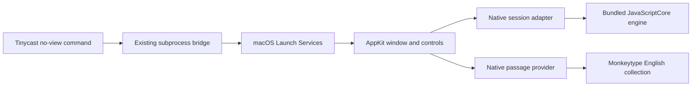

# Architecture and Scoring

## Tinycast integration

The extension launches an independent native helper window. Tinycast exposes List/Grid/Detail/Form components, but no public custom typing surface or callable internal SwiftUI theme/view functions. Using those standard components would not preserve the custom passage, per-character errors, and moving caret. This project does not modify Tinycast itself.

## Key modules

Paths below are relative to the project root.

- `src/extension/start-typing-practice.js`: CommonJS launcher using Tinycast’s assets/support directories, subprocess bridge, and failure toast. It identifies the launching stable/beta/dev channel and awaits Launch Services before the no-view context is destroyed.
- `src/native/TypingPractice.swift`: native window, modes/actions, footer/results, host binding, and lifecycle.
- `src/native/PassageRenderer.swift`: incremental highlighting, accepted/rejected editor reconciliation, and target-based caret/line layout.
- `src/native/NativeViews.swift`: native text services, keyboard gates, IME anchoring, drag regions, and progress drawing.
- `src/native/NativeSmoke.swift`: native QA scenarios, captures, deadlines, disposable preferences, and cleanup.
- `src/native/HostAppearance.swift`: read-only host appearance policy and filesystem observation.
- `src/native/TypingSession.swift`: one bulk input/tick snapshot across JavaScriptCore, cached display state, and literal UTF-16 revision/dirty-range tracking.
- `src/native/PassageProvider.swift`: ephemeral network fetch, JSON decoding, in-memory collection, and precomputed length-category indices.
- `src/engine/typing-session.js`: deterministic session/scoring implementation shared by JavaScriptCore and Node tests; no remote scripts or browser execution.
- `scripts/build.mjs`: packages the command, compiled helper, engine, and native font. It generates `dist/` for folder installs and root command/helper files for Tinycast’s GitHub installer; release mode combines both CPU architectures and ZIPs `dist/`. Edit sources, never generated packages.

The fixed target is rendered separately from the transparent native editor. The editor contains only committed input and active preedit; including the untyped target would let combining marks move AppKit’s insertion point backwards. IME candidate rectangles are anchored to the visible target caret, independent of prefix-only wrapping. Text remains data, never HTML or executable JavaScript.

`PassageRenderer` leaves ordinary accepted Cocoa edits in place and recolours only changed UTF-16 spans. Rejected/session edits use a minimal replacement without splitting surrogate pairs; marked composition is left alone. Passage/font changes rebuild the target, while theme changes or skipped revisions trigger a full colour refresh. Stable target layout and caret extent are reused.

The engine caches combined positional errors, counts, and completed-word state for the current target/prefix. Public returned ranges/results remain isolated from that cache. Native input/tick methods transfer a single snapshot instead of fetching properties individually; clock-only updates omit unchanged input data.

Footer labels are formatted/resized only when their values change, with WPM repositioned when countdown width changes. The results action retains keyboard focus and activation without drawing a focus-ring boundary.

## Appearance

The helper uses plain public `NSGlassEffectView` regular material, with no explicit tint or added black/white scrim. This matches the installed [Tinycast 0.12.8 glass wrapper](https://github.com/abue-ammar/tinycast/blob/v0.12.8/Tinycast/DesignSystem/GlassEffectView.swift) and [palette composition](https://github.com/abue-ammar/tinycast/blob/v0.12.8/Tinycast/Palette/RootPaletteView.swift#L350). The window is clear/nonopaque with a 26-point outer clip. macOS supplies the translucent glass finish; no WebKit or undocumented transparency switch is involved.

Tinycast exposes `environment.appearance` as a resolved light/dark snapshot, which loses the distinction between System and an explicit choice. Instead, the launcher derives the host channel from `environment.supportPath` and sends a validated `monkeytype-unoffical://open?host=…` URL explicitly addressed to the helper bundle. URL events also reach an already running instance.

`HostAppearanceObserver` reads only Tinycast’s persisted `appearance` key through public macOS preferences APIs. Only stable (`com.tinycast.app`), beta, and dev domains are accepted. Missing/unrecognised values default to System, matching Tinycast. System removes the helper’s appearance override so AppKit follows macOS live; Light/Dark apply the corresponding native appearance.

Filesystem events track preference writes and atomic replacements, without polling or changing any host setting. Metadata checks avoid reloading for unrelated preference-file activity. Theme changes preserve the active typing session; relaunching the extension is unnecessary. A fresh direct launch without Tinycast follows macOS.

This is a narrow compatibility bridge to Tinycast’s stored preference, not access to its internal SwiftUI views or a complete theme SDK. Review the key if Tinycast changes its settings implementation. Future/custom host design tokens are not automatically inherited.

## Passage selection

The provider downloads [Monkeytype’s public English collection](https://raw.githubusercontent.com/monkeytypegame/monkeytype/master/frontend/static/quotes/english.json). It uses the declared length groups: 0–100, 101–300, 301–600, and 601–9999 characters. All mode uses the entire collection; timed modes use extra-long passages.

The collection is cached in memory. New practice makes another random selection; restart keeps the same passage. Passage retrieval uses the public collection directly, not private host IPC.

## Scoring and session rules

- WPM = `Math.round(typedLength / (durationMs / 60000) / 5)`, including incorrect positions.
- Accuracy = currently correct positions / current typed length. Corrected/deleted mistakes do not incur a historical penalty.
- Reaching target length completes either mode, even with errors. Timed expiry records the actual one-second timer tick.
- Returning to a one-character prefix resets the start timestamp.
- Quote progress advances at correctly completed-word boundaries; timed progress follows elapsed seconds.
- Intentional safeguards: first multi-code-unit input starts timing; nonpositive duration scores finite 0 WPM.

## Reference and fidelity limits

Material compatibility is based on Tinycast **0.12.8**; review the integration points when updating the host.

The native passage font is upstream [JetBrains Mono](https://github.com/JetBrains/JetBrainsMono) under the SIL Open Font License in [`assets/fonts/OFL.txt`](../assets/fonts/OFL.txt), packaged with the helper. Passages retain their respective authors’ rights. No proprietary third-party code or artwork is bundled.

See [development.md](development.md#verification) for verification requirements and limits.
